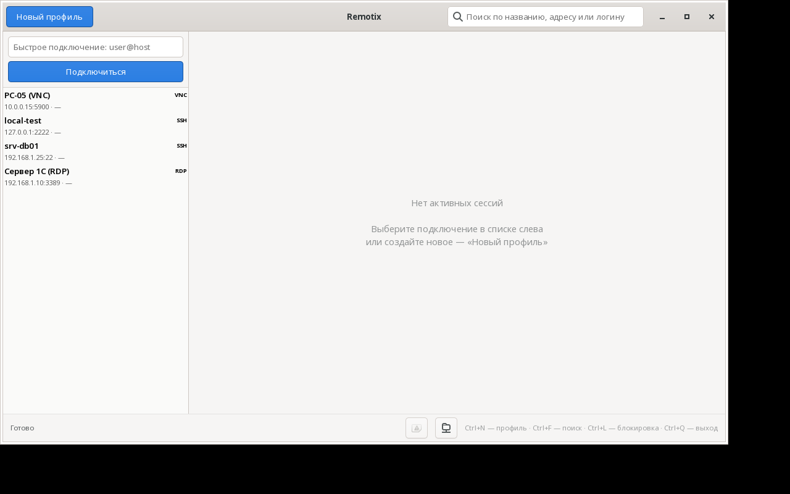
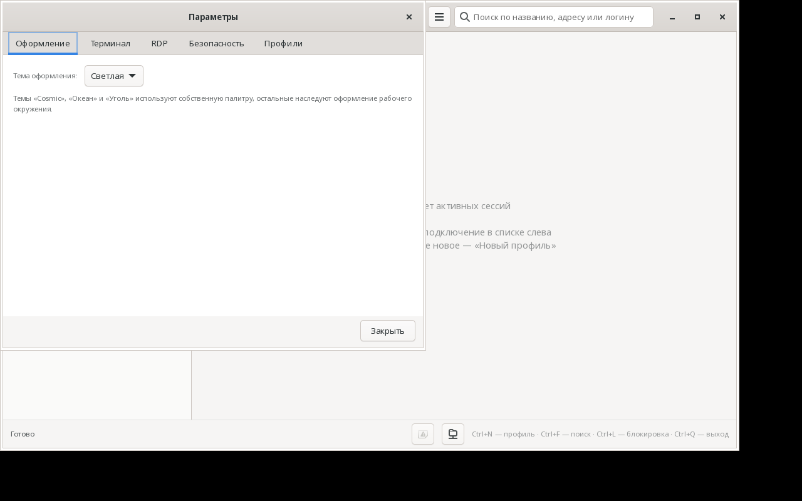
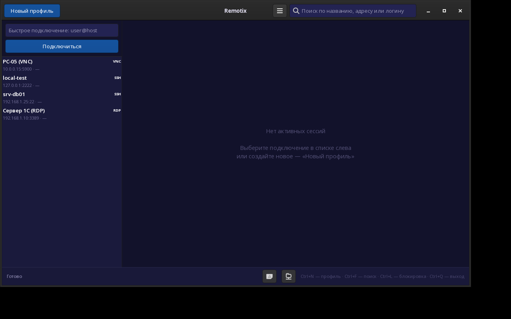
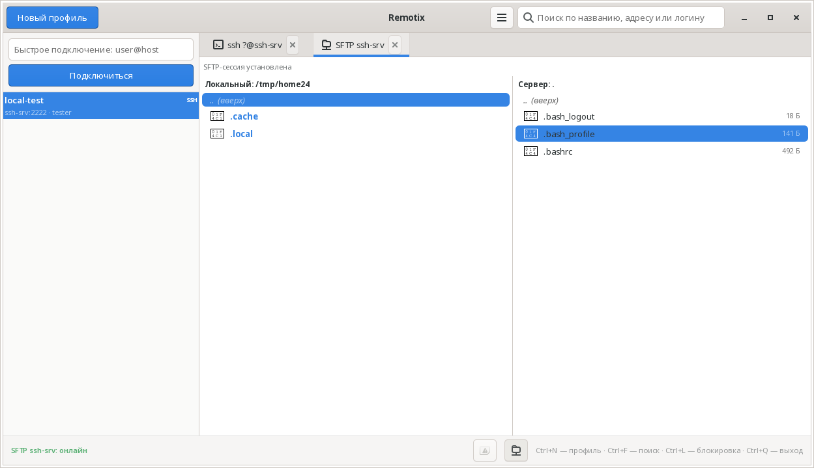

<div align="center">

# Remotix

**Клиент удалённого доступа (RDP · VNC · SSH) для РЕД ОС**

[](https://www.rust-lang.org/)
[](https://gtk.gnome.org/)
[](LICENSE)
[](#-установка)
[](https://github.com/flytimopheev-sketch/remotix/actions/workflows/build-rpm.yml)
[](https://github.com/flytimopheev-sketch/remotix/releases)

Единый интерфейс для подключения к удалённым рабочим столам и серверам.
Написан на Rust + GTK4, работает **полностью офлайн**: без облака, без телеметрии,
без внешних сервисов.

[Установка](#-установка) · [Сборка](#-сборка) · [Использование](#-использование) · [Архитектура](#-архитектура) · [Разработка](#-разработка) · [Лицензия](#-лицензия)

</div>

---

## 📋 О проекте

Remotix — это «одно окно» для всех удалённых подключений, которые администратор
обычно держит в разных программах: SSH-клиент, RDP-клиент, VNC-клиент, SFTP.
Профили хранятся локально, учётные данные зашифрованы мастер-паролем, а сама
программа не ходит в интернет.

Проект нацелен на **РЕД ОС 7 и 8** (EL7/EL9-совместимая платформа, GTK4 4.6+)
и собирается в виде RPM-пакета.

| Возможность | Состояние |
|---|---|
| Профили подключений: создание, правка, удаление, дублирование | ✅ готово |
| Мастер-пароль (Argon2id) + шифрование учётных данных (AES-256-GCM) | ✅ готово |
| SSH-подключение со встроенным терминалом (VTE / упрощённый) | ✅ готово |
| **RDP: просмотрщик удалённого рабочего стола (IronRDP, NLA/CredSSP)** | ✅ готово |
| SFTP: две панели, загрузка/скачивание, создание и удаление | ✅ готово |
| Журнал подключений с экспортом в CSV | ✅ готово |
| Быстрое подключение `user@host` без создания профиля | ✅ готово |
| Блокировка интерфейса по `Ctrl+L` | ✅ готово |
| Двухступенчатый вход SSH (admin → `su -` → root) | ✅ готово |
| **Параметры**: темы, терминал, RDP, смена мастер-пароля, импорт/экспорт | ✅ готово |
| **Пять тем оформления**: светлая, тёмная, Cosmic, Океан, Уголь | ✅ готово |
| Закрываемые вкладки сессий | ✅ готово |
| VNC | 🚧 в разработке |
| Группы профилей | 🚧 в разработке |

---

## 🖼 Интерфейс



Слева — список подключений с цветными тегами протоколов и быстрым
подключением, справа — вкладки активных сессий (терминал, удалённый рабочий
стол, SFTP, журнал). Внизу — строка состояния с индикатором текущей сессии.
Кнопка **☰** в шапке открывает главное меню, **Ctrl+,** — окно параметров.

| Параметры (`Ctrl+,`) | Тема «Cosmic» |
| --- | --- |
|  |  |

Темы: светлая, тёмная и собственные палитры **Cosmic**, **Океан** и **Уголь** —
переключаются в разделе «Оформление».



Полный HTML-макет лежит в репозитории — [`mockup.html`](mockup.html).

---

## ✨ Возможности

- **Единое окно.** Профили подключений, поиск по ним и встроенные терминалы —
  в одном приложении, без переключения между программами.
- **Безопасность по умолчанию.** Мастер-пароль разворачивает ключ Argon2id,
  учётные данные в SQLite лежат в виде AES-256-GCM. Сам мастер-пароль нигде
  не сохраняется — восстановить его нельзя.
- **Полный офлайн.** Нет облака, нет телеметрии, нет автообновлений. Все данные
  лежат в `~/.local/share/remotix`.
- **Аккуратный терминал.** Если в системе есть VTE для GTK4 — полноценная
  эмуляция (цвета, `vim`, `htop`); если нет — встроенный упрощённый терминал
  с копированием, вставкой и масштабом шрифта.
- **Тонкая настройка запуска.** Приложение корректно стартует и из меню
  рабочего окружения, и с переданным файлом/URI (см. [Troubleshooting](#-troubleshooting)).

---

## 📦 Установка

### Готовый RPM-пакет

```bash
sudo dnf install ./remotix-1.5.0-1.el9.x86_64.rpm
```

После установки Remotix появляется в меню приложений («Сеть → Remotix»),
а бинарник доступен как `/usr/bin/remotix`.

Файлы, которые ставит пакет:

| Путь | Назначение |
| --- | --- |
| `/usr/bin/remotix` | исполняемый файл приложения |
| `/usr/share/applications/remotix.desktop` | ярлык в меню |
| `/usr/share/icons/hicolor/scalable/apps/remotix.svg` | значок |
| `/usr/share/metainfo/remotix.metainfo.xml` | метаданные AppStream |
| `/usr/share/licenses/remotix/LICENSE` | текст лицензии |

Зависимости: `gtk4`, `libssh2`. Пакет `vte291-gtk4` желателен, но не обязателен:
без него SSH-терминал работает в упрощённом режиме.

### Готовые пакеты из релизов

Каждый тег `v*` запускает CI, который собирает RPM внутри окружения EL9 и
прикладывает пакеты к релизу:

<p align="center">
  <a href="https://github.com/flytimopheev-sketch/remotix/releases">
    
  </a>
</p>

---

## 🔧 Сборка

### Требования

| Компонент | Версия |
| --- | --- |
| Rust | stable (edition 2021) |
| GTK4 | 4.6+ |
| libssh2 | 1.9+ |
| OpenSSL | 1.1 / 3.x |
| pkg-config, gcc | любые |

Для РЕД ОС:

```bash
sudo dnf install gcc cargo rust pkg-config gtk4-devel libssh2-devel openssl-devel
```

### Из исходников

```bash
git clone https://github.com/flytimopheev-sketch/remotix.git
cd remotix
cargo build --release
./target/release/remotix
```

FreeRDP не требуется: RDP реализован на чистом Rust (IronRDP). VTE для GTK4
нужен только во время выполнения и подключается динамически, поэтому при сборке
пакета `vte291-gtk4-devel` не обязателен.

### Сборка RPM

```bash
./make-rpm-sources.sh          # подготовит исходники и соберёт пакет
# либо вручную:
rpmbuild -bb packaging/remotix.spec
sudo dnf install ~/rpmbuild/RPMS/*/remotix-*.rpm
```

CI собирает пакет **внутри окружения AlmaLinux 9 (EL9)** — это тот же уровень
платформы, что и РЕД ОС 8 (glibc 2.34, OpenSSL 3, GTK4 4.6+). Docker не
используется: окружение разворачивается обычным `chroot` в rootfs AlmaLinux 9
(`packaging/ci/el9-chroot.sh`). Подробности — в [разработке](#разработка).

---

## 🚀 Использование

### Первый запуск

1. Remotix попросит придумать **мастер-пароль** — это ключ ко всем сохранённым
   паролям. Он нигде не хранится: запомните его или сохраните в менеджере
   паролей. Забытый мастер-пароль восстановить нельзя.
2. Нажмите **«Новый профиль»** (`Ctrl+N`) и опишите подключение: протокол
   (SSH / RDP / VNC), адрес, порт, логин и пароль. Для RDP дополнительно
   выбирается разрешение экрана и домен, для SSH — путь к ключу и режим входа
   под root.
3. Дважды щёлкните по профилю в списке слева — откроется сессия:
   для SSH — встроенный терминал, для RDP — удалённый рабочий стол.
4. Кнопки в строке состояния открывают **журнал подключений** и **SFTP-клиент**.

### Быстрое подключение

Не хочется заводить профиль? Введите `user@host` в поле быстрого подключения
и нажмите Enter — откроется SSH-сессия.

### Горячие клавиши

| Комбинация | Действие |
| --- | --- |
| `Ctrl+N` | Новый профиль |
| `Ctrl+F` | Фокус в строке поиска |
| `Ctrl+L` | Заблокировать интерфейс |
| `Ctrl+,` | Параметры |
| `Ctrl+I` | О программе |
| `Ctrl+Q` | Выход |
| `Ctrl+Shift+C` / `Ctrl+Shift+V` | Копировать / вставить в терминале |
| `Ctrl+`+` / `Ctrl+`-` | Масштаб шрифта терминала |

### Управление профилями

- **Создать** — кнопка «Новый профиль» в шапке окна (`Ctrl+N`).
- **Изменить** — правый клик по профилю → «Изменить…» (или кнопка в редакторе).
- **Дублировать** — правый клик по профилю → «Дублировать»: копия создаётся
  сразу, с именем «<профиль> (копия)».
- **Удалить** — правый клик по профилю → «Удалить» (с подтверждением) или
  кнопка «Удалить профиль» в редакторе.
- **Подключиться** — двойной щелчок по профилю.

### Файловый менеджер SFTP

Вкладка SFTP — двухпанельный менеджер (локальный каталог слева, каталог на
сервере справа) с управлением как в Far/Midnight Commander:

| Клавиша | Действие |
| --- | --- |
| `↑` / `↓` | Перемещение по списку |
| `Enter` | Войти в каталог |
| `Backspace` | Перейти в родительский каталог |
| `Tab` | Переключить панель |
| `F5` | Скопировать из активной панели в другую |
| `F6` | Переименовать |
| `F7` | Создать каталог |
| `F8` | Удалить |
| `F10` | Закрыть вкладку |
| `Ctrl+R` | Обновить список |

Каталоги показаны жирным синим со значком 📁, файлы — обычным цветом со
значком 📄 и размером справа.

### Параметры

`Ctrl+,` или кнопка «☰» → «Параметры…»:

| Раздел | Что настраивается |
| --- | --- |
| **Оформление** | Тема: светлая, тёмная, Cosmic, Океан, Уголь |
| **Терминал** | Шрифт, размер, мигание курсора, цветовая схема |
| **RDP** | Разрешение экрана, NLA (CredSSP), буфер обмена, глубина цвета, `Ctrl+Alt+Del` |
| **Безопасность** | Смена мастер-пароля (все сохранённые пароли перешифровываются) |
| **Профили** | Импорт и экспорт профилей в JSON |

### Удалённый рабочий стол (RDP)

Вкладка RDP показывает экран удалённой машины и передаёт клавиатуру и мышь.
Поддерживается аутентификация NLA (CredSSP) — как на современных серверах
Windows 10/11 и RDS; если сервер NLA не поддерживает, Remotix повторяет
подключение по TLS. Кнопка `Ctrl+Alt+Del` в панели просмотрщика отправляет
соответствующую последовательность в удалённую сессию.

### Где лежат данные

```
~/.local/share/remotix/remotix.db     # профили, группы, история подключений
```

Путь берётся из `$XDG_DATA_HOME/remotix`, если переменная задана.
Экспорт журнала подключений — `~/remotix-history.csv`.

---

## 🏗 Архитектура

### Стек

| Слой | Технологии |
| --- | --- |
| Интерфейс | Rust + GTK4 (`gtk4-rs`), CSS-оформление, без веб-технологий |
| Хранилище | SQLite (`rusqlite`, bundled) |
| Криптография | Argon2id + AES-256-GCM |
| SSH | `ssh2` (libssh2) |
| RDP | IronRDP (чистый Rust, без FreeRDP), NLA/CredSSP |
| Терминал | VTE для GTK4 (динамическая загрузка) + упрощённый терминал |
| Упаковка | RPM для РЕД ОС / EL9 |

### Структура проекта

```
remotix/
├── src/
│   ├── main.rs              # точка входа, настройка GApplication
│   ├── app.rs               # запуск, главное окно, «О программе»
│   ├── config.rs            # пути данных (XDG)
│   ├── settings.rs          # настройки приложения (тема, терминал, RDP)
│   ├── profiles_io.rs       # импорт и экспорт профилей (JSON)
│   ├── db/                  # mod, schema, crypto, repository
│   ├── models/              # mod, profile
│   ├── protocols/           # mod, rdp, vnc, ssh
│   └── ui/                  # main_window, profile_editor, master_password,
│                            # terminal, rdp_viewer, sftp_tab, history_tab,
│                            # settings_window, theme
├── resources/icons/remotix.svg
├── packaging/               # remotix.spec, .desktop, .metainfo.xml, ci/
├── examples/keyprobe.rs     # отладка клавиатурного ввода (RDP)
├── .github/workflows/       # сборка RPM
└── mockup.html              # макет интерфейса
```

### Схема базы данных

`meta` (соль Argon2, параметры, верификатор), `groups`, `profiles`
(учётные данные — BLOB, зашифрованный AES-256-GCM), `connection_history`.
Подробности — в [`src/db/schema.rs`](src/db/schema.rs).

### Принципы

- Никакого облака и внешней синхронизации.
- Никакой телеметрии.
- Все зависимости — из офлайн-репозитория РЕД ОС или из исходников.
- Поддержка тёмной темы GTK и `ssh-agent`.

---

## 🛠 Разработка

```bash
git clone https://github.com/flytimopheev-sketch/remotix.git
cd remotix

cargo fmt
cargo clippy --all-targets
cargo test
```

Зависимости crates.io лежат в каталоге `vendor/` — сборка идёт полностью
офлайн (`.cargo/config.toml` подменяет crates.io на локальный каталог).
Чтобы обновить зависимости:

```bash
mv .cargo/config.toml /tmp/ && rm -rf vendor
cargo vendor vendor && mv /tmp/cargo-config.toml .cargo/
```

### CI

`.github/workflows/build-rpm.yml` на каждом пуше в `main` и на тегах `v*`:

1. разворачивает окружение EL9 (`chroot`, без Docker);
2. пересобирает `vendor/` и собирает бинарник в release;
3. выполняет **smoke-тест** в виртуальном X-сервере (`xvfb-run`): приложение
   должно запуститься, показать окно и остаться живым;
4. собирает бинарный RPM и SRPM и выкладывает их в артефакты и релиз.

### Как отлаживать запуск на РЕД ОС

```bash
remotix --version          # версия
REMOTIX_MASTER_PASSWORD=test remotix   # автозапуск без диалога мастер-пароля
strace -f -o /tmp/remotix.strace remotix  # если окно не появляется
```

Если в логе видно `GLib-GIO-CRITICAL **: This application can not open files.`,
значит приложение было запущено с аргументами (например, рабочее окружение
передало URI), а GApplication не знал, что с ними делать. В Remotix это
обрабатывается флагом `G_APPLICATION_HANDLES_OPEN` и обработчиком сигнала
`open` — см. [`src/main.rs`](src/main.rs).

---

## ❓ Troubleshooting

| Симптом | Причина и решение |
| --- | --- |
| `This application can not open files.` | Приложение запущено с аргументами, а флаг `HANDLES_OPEN` не выставлен. Уже исправлено в 1.1.0; соберите пакет из актуального `main`. |
| `error while loading shared libraries: libvte-2.91-gtk4.so.0` | Пакет собран с жёсткой привязкой к VTE. VTE подключается динамически — пересоберите пакет из текущего `main`. |
| `error while loading shared libraries: libgtk-4.so.1` | На целевой системе нет GTK4: `sudo dnf install gtk4`. |
| Окно не появляется, в логе пусто | Запустите из терминала: так видны сообщения GTK. Проверьте `~/.local/share/remotix/remotix.db` — база создаётся автоматически. |
| Терминал без цветов, нет `vim` | Не установлен `vte291-gtk4` — приложение использует упрощённый терминал. |

---

## 🗺 Дорожная карта

- [x] RPM-пакет для РЕД ОС, сборка в окружении EL9
- [x] Мастер-пароль и шифрование учётных данных
- [x] SSH-сессии во встроенном терминале
- [x] Профили подключений, поиск, быстрое подключение
- [x] Журнал подключений и экспорт в CSV
- [x] Просмотрщик RDP с поддержкой NLA (CredSSP)
- [x] SFTP-клиент с двумя панелями
- [x] Современный интерфейс в стиле GTK4
- [ ] Поддержка VNC
- [ ] Группы профилей, импорт/экспорт (JSON)
- [ ] Двухсторонний буфер обмена RDP (CLIPRDR)
- [ ] `Ctrl+Alt+Del` в RDP-сессии

---

## 🤝 Участие в проекте

Будут рады любой помощи —Issues, идеи, код, отчёты об ошибках:

1. Откройте [Issue](https://github.com/flytimopheev-sketch/remotix/issues) или
   [Discussions](https://github.com/flytimopheev-sketch/remotix/discussions).
2. Для правок — форкните репозиторий и пришлите Pull Request.
3. Перед отправкой прогоните `cargo fmt`, `cargo clippy` и `cargo test`.

Подробности — в [CONTRIBUTING.md](CONTRIBUTING.md).

---

## 📄 Лицензия

Remotix распространяется по лицензии **MIT** — полный текст в файле
[`LICENSE`](LICENSE).

```
MIT License
Copyright (c) 2026 flytimopheev <flytimopheev@gmail.com>
```

---

## 👤 Автор и контакты

**flytimopheev** — <flytimopheev@gmail.com>

По любым вопросам, багам и предложениям пишите на почту, буду рад обратной
связи! 📬

<p align="center">
  <a href="https://github.com/flytimopheev-sketch/remotix/issues">
    
  </a>
  <a href="https://github.com/flytimopheev-sketch/remotix">
    
  </a>
</p>

---

<div align="center">
  <sub>Сделано с ❤️ для РЕД ОС</sub>
</div>
